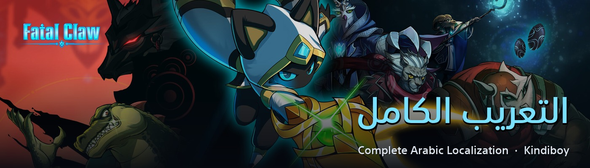
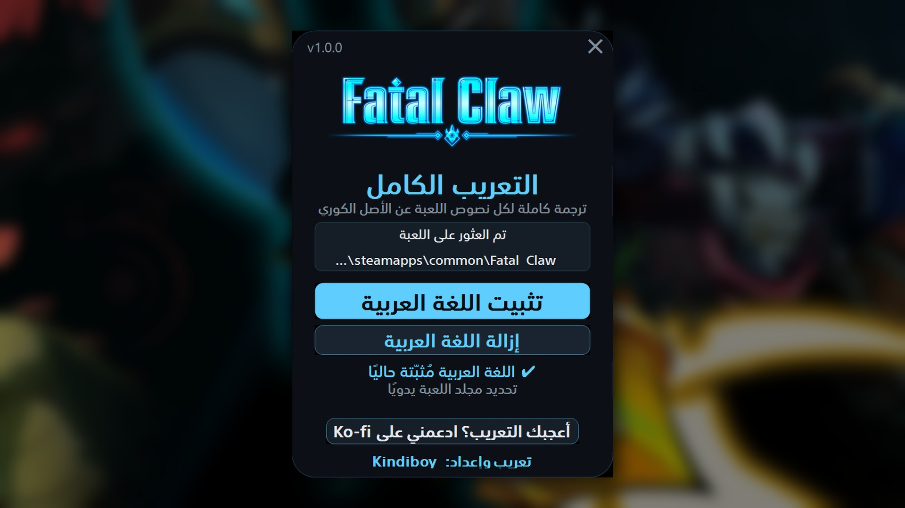

<h1 align="center">Fatal Claw — التعريب الكامل</h1>

Complete Arabic localization for <b>Fatal Claw</b> (Steam) · تعريب كامل للعبة

  <a href="https://github.com/faisalkindi/FatalClaw-Arabic/releases/latest/download/FatalClaw_Arabic_Installer.zip"><b>⬇ تحميل المثبّت / Download installer</b></a>
  &nbsp;·&nbsp;
  <a href="https://github.com/faisalkindi/FatalClaw-Arabic/releases/latest/download/FatalClaw_Arabic_Manual.zip">ملفات التثبيت اليدوي / Manual files</a>
  &nbsp;·&nbsp;
  <a href="https://github.com/faisalkindi/FatalClaw-Arabic/releases">كل الإصدارات / All releases</a>
  &nbsp;·&nbsp;
  <a href="https://ko-fi.com/kindiboy">☕ Ko-fi</a>

---

## العربية

**ماذا يعرّب؟** كل نصوص اللعبة (3,559 سطرًا): الحوارات، المشاهد السينمائية، المذكّرات، الأصناف، المهارات، أسماء المناطق، والقوائم — ترجمة مباشرة عن النصّ الكوريّ الأصلي، لا نقلًا عن الإنجليزية.

**المميزات**
- تُضاف العربية كلغة حادية عشرة داخل قائمة اللغات (تظهر باسم «العربية») ولا تستبدل أي لغة أخرى.
- خط عربي مخصّص (SST Arabic) مُضاف إلى جانب خطوط اللعبة الأصلية، فتبقى بقية اللغات كما صمّمها المطوّر.
- اتجاه صحيح من اليمين إلى اليسار ووصل سليم للحروف في كامل الواجهة، وأرقام غربية (1 2 3).
- مصطلحات موحّدة عبر اللعبة كلها بمسرد مُراجَع لأسماء الشخصيات والفصائل والأماكن والأصناف.
- ملفّ إضافيّ واحد؛ لا يعدَّل أي ملف أصلي. الإزالة بنقرة واحدة.

**التثبيت (المثبّت)**
1. أغلق اللعبة.
2. حمّل `FatalClaw_Arabic_Installer.zip` من الرابط أعلاه وفكّ الضغط.
3. شغّل `Fatal Claw Arabic Installer.exe` — يكتشف مجلد اللعبة من Steam تلقائيًا (أو حدّده يدويًا) — ثم اضغط «تثبيت اللغة العربية».
4. داخل اللعبة: الإعدادات ← اللغة ← «العربية».

**التثبيت اليدوي**: فكّ `FatalClaw_Arabic_Manual.zip` واستخرج `FatalClawArabic_P.pak` ثم انسخه إلى `...\steamapps\common\Fatal Claw\FatalClaw\Content\Paks\` (بجانب `FatalClaw-WindowsNoEditor.pak`).

**الإزالة**: المثبّت ← «إزالة اللغة العربية»، أو احذف `FatalClawArabic_P.pak` من مجلد Paks.

## English

**What it covers.** Every line in the game (3,559 strings): dialogue, cinematics, journal entries, items, skills, region names and menus — translated directly from the original Korean script, not relayed through English.

**Features**
- Arabic is added as a genuine 11th language («العربية» in the language menu); none of the original ten is replaced.
- A dedicated Arabic font (SST Arabic) added alongside the game's own fonts, so every other language keeps its original design.
- Proper right-to-left flow and correct letter shaping across the interface, with Western digits (1 2 3).
- Consistent terminology via a curated glossary for characters, factions, places and items.
- A single add-on file; no original game file is modified. One-click uninstall.

**Install (installer)**
1. Close the game.
2. Download `FatalClaw_Arabic_Installer.zip` above and unzip it.
3. Run `Fatal Claw Arabic Installer.exe`; it finds the Steam install automatically (or pick the folder), then click the blue install button.
4. In game: Options → Language → «العربية».

**Manual install**: unzip `FatalClaw_Arabic_Manual.zip` and copy `FatalClawArabic_P.pak` into `...\steamapps\common\Fatal Claw\FatalClaw\Content\Paks\` (next to `FatalClaw-WindowsNoEditor.pak`).

**Uninstall**: installer → uninstall button, or delete `FatalClawArabic_P.pak` from the Paks folder.

## Screenshots

## Notes

- Version 1.0 for the Steam release. Steam's "Verify integrity of game files" does not remove the mod (it is an extra file, not a replaced one).
- Numbers use Western digits (1 2 3); decimals display as `1,5` and thousands as `1.234` due to the locale the game's text engine ships for Arabic.
- Compatibility: other mods that modify the language menu widgets or the game's composite font will conflict.
- Font: SST Arabic (Samsung), used for non-commercial purposes only.
- Report any typo, clipped label or mistranslation in [Issues](https://github.com/faisalkindi/FatalClaw-Arabic/issues) — every report is folded into the next version.
- Contributors: see [`PIPELINE.md`](PIPELINE.md) for how the corpus, glossary, font and installer are built.

تعريب وإعداد: <b>Kindiboy</b>

